# Revisão do artigo — gráficos, limiares e descrições

> Feita em 10/11/2026 a partir da conversa com o orientador, do `ART_TCC.pdf` e dos dados do experimento (`back/avaliacao_metricas/`). Todos os números foram recalculados. As figuras revisadas estão em `estudo_defesa/figuras_revisadas/`.

---

## 0. Resumo para levar ao orientador

1. **Todos os gráficos e tabelas conferem com os dados.** Não há número inventado. Os problemas são de **apresentação**: nomes de código nas figuras, arredondamento, uma tabela citada que não existe e legendas que não explicam o que o leitor está vendo.
2. **Sobre o limiar baixo da Figura 5:** o eixo X é a **nota da métrica**, não a porcentagem de acerto da resposta, e cada métrica tem uma escala diferente. Uma paráfrase correta tira 0,04 no BLEU. Exigir limiar ≥ 0,5 **não muda o topo do ranking** (G-Eval, METEOR e chrF continuam empatados), mas derruba injustamente as métricas de escala comprimida (BLEU, ROUGE-2 e ROUGE-L).
3. **A preocupação de fundo do orientador procede:** a AUC soma a curva inteira, inclusive limiares que ninguém usaria. A ferramenta da literatura para isso é a **AUC parcial** (McClish, 1989). Calculada só na zona com até 10% de falsos positivos, ela confirma o resultado: chrF 0,888, METEOR 0,885 e G-Eval 0,883.
4. **Recomendação:** manter o método, trocar a Figura 5 pela versão revisada (faixa completa, com a região abaixo de 0,5 destacada e a legenda explicando o eixo) e acrescentar um parágrafo com a AUC parcial. A versão "a partir de 0,5" também está pronta, caso o orientador prefira (seção 2.5).
5. **Pedidos repassados pelo Pego em 11/11:** estão na seção 12, com o que já estava feito, por que fazer, o que evitar e os textos prontos (mapa de coerência texto × figura, legendas, justificativas, tabelas, "G-Eval" e acurácia balanceada, AUC e ROC).
6. **Revisão completa do texto (11/11):** seção 13. Achei duas frases incoerentes sobre a G-Eval na seção 5.3, coisas que o método usa mas não explica (limiar estratificado, Hit@5, DeepEval) e duas condições do experimento que não estão declaradas. A seção 13.6 lista as 8 decisões a tomar antes de editar.
7. **Pendências que dependem da decisão de vocês:** corrigir 0,968 → 0,967 (G-Eval) e 0,920 → 0,921 (projeto de referência); trocar as Figuras 5 a 8; incluir o texto de método que falta (seção 4).

---

## 1. O que o orientador pediu na conversa

| # | Pedido | Onde está a resposta |
|---|---|---|
| 1 | Figura 5: limiares muito baixos aprovam respostas "sem similaridade nenhuma"; refazer a partir de 0,5 | Seção 2 |
| 2 | "Por que essas métricas e não todas?" (Figuras 5 e 8) | Seções 2.6 e 5 (justificativas) e figura complementar com as 15 |
| 3 | Confirmar se os resultados dos gráficos batem com os dados | Seção 3 |
| 4 | Deixar só o nome da métrica nos gráficos (sem `geval_correctness`, `hallucination_inv`…) | Figuras 6 e 7 revisadas |
| 5 | Explicar o que cada métrica mede, como funciona, o que calcula e qual o objetivo ("o que a métrica traduz") | Seção 7 |
| 6 | Categorizar as métricas por eixo de avaliação | Seção 6 |
| 7 | Descrições mais detalhadas dos gráficos, para o leitor não tirar conclusão própria | Seção 5 |
| 8 | Discussão do tipo "com RAG, alucina menos e acerta mais" | Seção 8 |
| 9 | Não exagerar na apresentação ("se restrinja ao que tá no papel"); cuidado com "sociotécnico" | Seção 10 |

---

## 2. A Figura 5 e a questão do limiar baixo

### 2.1 O que a figura mostra
Para cada métrica, a curva dá a **acurácia balanceada** obtida ao aprovar as respostas cuja **nota da métrica** é maior ou igual ao limiar do eixo X. O cálculo usa as 240 respostas, com o limiar ajustado nos próprios dados. Os pontos foram conferidos: METEOR 0,900 em 0,35; G-Eval 0,913 em 0,40; ROUGE-L 0,883 em 0,25; BERTScore 0,880 em 0,70; Answer Relevancy 0,525 em 0,95. **A figura está correta.**

### 2.2 Onde a leitura do orientador procede e onde não se aplica

**Procede:**
- A **AUC** (Figuras 7 e 8 e Tabela 3) soma o desempenho em **todos** os limiares, inclusive os permissivos, que aprovam quase tudo e não teriam uso real. É uma crítica conhecida da AUC.
- O artigo **não explica o que é o eixo X**. Sem isso, o leitor tende a ler "limiar 0,35" como "35% da resposta está certa".

**Não se aplica literalmente:**
- O limiar está **na escala de cada métrica**, e as escalas são muito diferentes. Quem decide se a resposta está certa é a **régua de fatos-chave** (seção 4.1 do artigo), não a nota da métrica.
- Evidência do laboratório com respostas controladas (`ESTUDO_DETALHADO.md`, seção 4), para o gabarito "A equipe competiu pela primeira vez em 2015 na LARC":

| Resposta | É correta? | BLEU | ROUGE-2 | METEOR | BERTScore |
|---|---|---|---|---|---|
| "A estreia da equipe em competições foi na LARC, no ano de 2015." | **sim** | 0,04 | 0,10 | 0,41 | 0,83 |
| "A equipe competiu pela primeira vez em 2016 na LARC." | **não** | 0,71 | 0,78 | 0,90 | 1,00 |

Uma resposta **correta** tira 0,04 no BLEU, e uma **errada** tira 1,00 no BERTScore. Então "nota abaixo de 0,5" não quer dizer "menos da metade correta".

### 2.3 O que acontece se exigirmos limiar a partir de 0,5

Acurácia balanceada validada (leave-one-model-out), recalculada:

| Métrica | Limiar livre (artigo) | Limiar ≥ 0,5 | Limiar ≥ 0,6 | Efeito |
|---|---|---|---|---|
| G-Eval | 0,872 | 0,881 | 0,871 | quase igual |
| BERTScore | 0,880 | 0,880 | 0,880 | igual (já usava 0,70) |
| chrF | 0,872 | 0,872 | 0,884 | igual |
| METEOR | 0,862 | 0,867 | 0,868 | quase igual |
| Token F1 | 0,846 | 0,849 | 0,843 | quase igual |
| ROUGE-1 | 0,833 | 0,849 | 0,839 | quase igual |
| ROUGE-L | 0,875 | **0,819** | 0,819 | cai |
| ROUGE-2 | 0,882 | **0,798** | 0,767 | cai |
| BLEU | 0,859 | **0,745** | 0,714 | cai muito |
| Projeto de referência | 0,814 | 0,814 | 0,804 | igual |
| Cosseno | 0,824 | 0,824 | 0,824 | igual |
| Hallucination, Exact Match, Faithfulness, Answer Relevancy | 0,50–0,66 | igual | igual | continuam no acaso |

**Leitura:** a restrição não muda a conclusão central (G-Eval, METEOR, chrF e BERTScore no topo, relevância e fidelidade no acaso). O que ela faz é **punir as métricas de escala comprimida**: o BLEU-4, que mede sequências de até 4 palavras, raramente passa de 0,5 mesmo em respostas certas.

### 2.4 A resposta da literatura: AUC parcial

A **AUC parcial padronizada** (McClish, 1989) calcula a área só numa faixa da curva ROC. Usamos a faixa de **até 10% de falsos positivos** (até 17 das 171 respostas erradas aprovadas): é a zona de decisão rigorosa, a que interessa num chatbot institucional. A escala vai de 0,5 (acaso) a 1 (separação perfeita), como a AUC comum.

| Métrica | AUC total | AUC parcial (FP ≤ 10%) | AUC parcial (FP ≤ 20%) |
|---|---|---|---|
| chrF | 0,963 | **0,888** | 0,914 |
| METEOR | 0,966 | **0,885** | 0,916 |
| G-Eval | 0,967 | **0,883** | 0,922 |
| Token F1 | 0,946 | 0,838 | 0,876 |
| ROUGE-L | 0,952 | 0,836 | 0,888 |
| ROUGE-1 | 0,943 | 0,834 | 0,870 |
| ROUGE-2 | 0,945 | 0,821 | 0,873 |
| BLEU | 0,951 | 0,816 | 0,875 |
| BERTScore | 0,944 | 0,778 | 0,853 |
| Projeto de referência | 0,921 | 0,716 | 0,806 |
| Cosseno | 0,903 | 0,691 | 0,771 |
| Exact Match | 0,594 | 0,594 | 0,594 |
| Hallucination | 0,658 | 0,514 | 0,530 |
| Faithfulness | 0,557 | 0,503 | 0,505 |
| Answer Relevancy | 0,520 | 0,502 | 0,503 |

**Leitura:** na zona rigorosa, chrF, METEOR e G-Eval continuam empatados no topo. As semânticas perdem mais (BERTScore cai de 0,944 para 0,778), porque dão notas altas a respostas erradas que falam do mesmo assunto. Isso **reforça** o resultado do artigo e responde à objeção "a AUC está somando uma região que não interessa".

Figura: `figuras_revisadas/fig_nova_auc_parcial.png`.

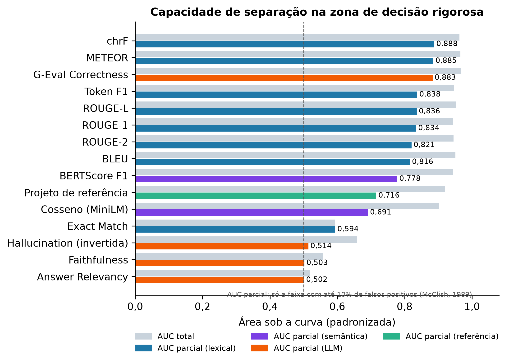

### 2.5 Recomendação e opções

| Opção | O que muda | Consequências |
|---|---|---|
| **A (recomendada):** manter o método; trocar a Figura 5 pela versão revisada e acrescentar a AUC parcial | Figura 5 + legenda + 1 parágrafo; nova figura ou uma frase com os números da AUC parcial | Nada muda nas Tabelas 3 e 5, na Figura 9, no resumo nem nos slides. Responde à crítica com uma ferramenta citável |
| **B:** adotar limiar mínimo de 0,5 como regra do método | Refazer as Tabelas 3 e 5, a Figura 9, o texto 5.3 e 5.4, o resumo e os slides 11 e 12 | A matriz da METEOR mudaria (FP 6, FN 16). BLEU, ROUGE-2 e ROUGE-L cairiam. Perde coerência a menos de uma semana da defesa |
| **C:** manter o método e incluir também a figura "a partir de 0,5" | Uma figura a mais, com legenda dizendo que é uma restrição ilustrativa | Ocupa espaço; precisa explicar por que os melhores limiares de METEOR e ROUGE-L somem |

**Atenção:** só cortar o eixo da Figura 5 a partir de 0,5, sem mudar o resto, cria uma **incoerência**. A Tabela 3 continuaria dizendo que o limiar da METEOR é 0,35 e o do ROUGE-L 0,25, pontos que não apareceriam no gráfico.

**Figuras prontas:**

Versão recomendada (opção A):

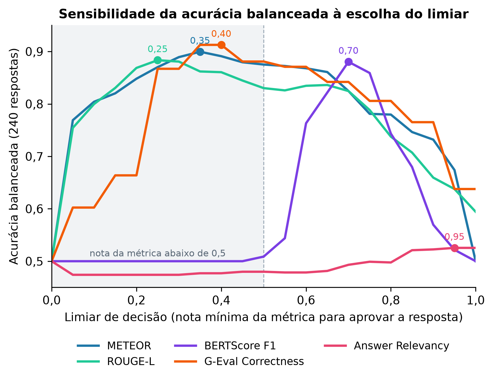

Versão pedida, a partir de 0,5 (opções B e C):

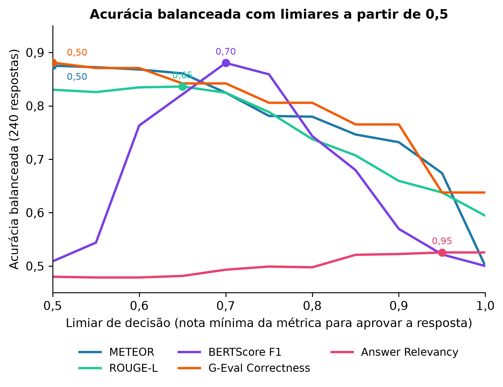

Complementar, com as 15 métricas (responde "por que não todas"):

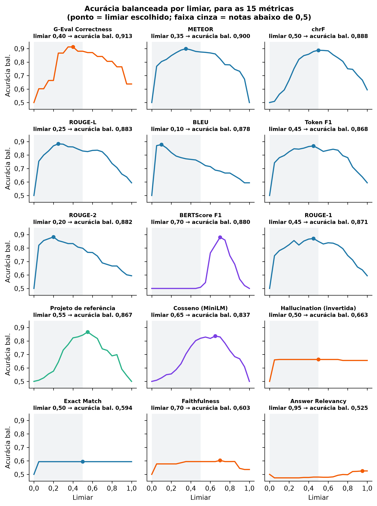

### 2.6 Texto proposto para o artigo (opção A)

**Legenda da Figura 5:**
> Figura 5 - Acurácia balanceada de métricas representativas em função do limiar de decisão (240 respostas; limiar ajustado sobre o conjunto completo). O eixo horizontal é a nota mínima que a métrica precisa atribuir para a resposta ser aprovada; os pontos marcam o limiar de maior acurácia balanceada de cada métrica; a faixa cinza indica notas abaixo de 0,5.

**Parágrafo depois da figura (substitui o atual "As curvas revelam comportamentos distintos…"):**
> O limiar não representa uma porcentagem de acerto da resposta: ele é expresso na escala própria de cada métrica, e essas escalas diferem bastante. Métricas de sobreposição de n-gramas atribuem notas baixas mesmo a paráfrases corretas e, por isso, atingem seu melhor desempenho abaixo de 0,5 (ROUGE-L em 0,25 e METEOR em 0,35). O BERTScore, calculado sem reescalonamento, atribui notas próximas de 0,6 até a textos sem relação e só passa a discriminar a partir de 0,6, com melhor limiar em 0,70. A correção de cada resposta não é definida pelo limiar, mas pelo rótulo de referência baseado em fatos-chave (Seção 4.1). A curva evidencia, portanto, o quanto o desempenho depende do ponto de corte: METEOR e G-Eval mantêm acurácia balanceada acima de 0,85 numa faixa ampla de limiares, o BERTScore só é útil numa faixa estreita, e a Answer Relevancy permanece próxima de 0,5 em qualquer limiar, o que indica que o problema dessa métrica não é de calibração. Os valores da figura foram obtidos com o limiar ajustado sobre todo o conjunto; na validação cruzada leave-one-model-out, a acurácia balanceada da G-Eval cai de 0,913 para 0,872 e a da METEOR de 0,900 para 0,862 (Tabela 3).

**Parágrafo novo sobre a AUC parcial (fim da seção 5.3):**
> Como a AUC agrega todos os limiares, inclusive faixas permissivas sem uso prático, calculou-se também a AUC parcial padronizada (MCCLISH, 1989), restrita à região com até 10% de falsos positivos, a mais relevante para um chatbot institucional, em que aprovar uma resposta incorreta é o erro mais grave. Nessa região, chrF (0,888), METEOR (0,885) e G-Eval (0,883) permanecem praticamente empatados; as métricas semânticas perdem mais capacidade de separação (BERTScore, 0,778; similaridade por cosseno, 0,691), e Hallucination, Faithfulness e Answer Relevancy permanecem próximas do acaso (0,50 a 0,51). Restringir os limiares a valores a partir de 0,5 também não altera as métricas de melhor desempenho, mas penaliza as de escala comprimida, como BLEU (de 0,859 para 0,745) e ROUGE-2 (de 0,882 para 0,798).

**Referência a acrescentar:**
> MCCLISH, D. K. Analyzing a portion of the ROC curve. Medical Decision Making, v. 9, n. 3, p. 190–195, 1989.

---

## 3. Conferência de cada tabela e figura com os dados

| Item | Confere? | Observação |
|---|---|---|
| Tabela 1 | ✓ | Os valores de p estão como "1,91e-06"; em texto científico, prefira "1,91 × 10⁻⁶" |
| Figura 1 | ✓ | |
| Figura 2 | ✓ | Gráfico "borboleta": o lado sem RAG cresce para a esquerda, e o eixo mostra 60, 40, 20 à esquerda do zero. Explicar na legenda |
| Figura 3 | ✓ | Rótulo "GPT-5" deveria ser "GPT-5 mini" |
| Figura 4 | ✓ | **Soma com e sem RAG**, e isso não está dito. Ver seção 4, item 5 |
| Tabela 2 | ✓ | Não diz que são 20 perguntas |
| Figura 5 | ✓ | Ver seção 2 |
| Tabela 3 | ✓ | G-Eval 0,968 deveria ser 0,967; projeto de referência 0,920 deveria ser 0,921. As colunas misturam o limiar ajustado em tudo com BAs validadas, e a legenda não diz |
| Figura 6 | ✓ | Nomes de código; versão revisada pronta |
| Figura 7 | ✓ | Nomes de código; G-Eval como 0,968; versão revisada pronta |
| Figura 8 | ✓ | Legenda com ponto decimal; não explica por que essas 5 métricas |
| Tabela 5 | ✓ | Não diz que usa o limiar global |
| Figura 9 | ✓ | Normalizada pela classe real: o texto explica, a legenda não |

---

## 4. Problemas no texto e correções propostas

1. **"Tabela 4" inexistente** (fim da seção 5.3). Trocar por "Tabela 3".
2. **Arredondamento da AUC da G-Eval.** O valor exato é 0,96745. Com três casas, é 0,967, como na Figura 8. O resumo não cita o número. Corrigir na Tabela 3, na Figura 7 e no texto da seção 5.3 ("G-Eval apresenta a maior AUC, 0,967, muito próxima de METEOR (0,966)…"). O mesmo para o projeto de referência: 0,921. Nos slides fixos, a defesa explica (Roteiro G2).
3. **Nomes de código nas figuras** (Figuras 6 e 7): trocar `geval_correctness`, `hallucination_inv`, `cosine_minilm`, `ref_projeto`, `token_f1`, `exact_match`, `bertscore_f1` pelos nomes usados no texto. Figuras revisadas prontas.
4. **"Métrica de referência específica do projeto"** (seção 4.2): ambíguo, parece que vocês a criaram. Propor: *"…além da pontuação adotada no projeto de referência que motivou este estudo (0,8 × similaridade por cosseno MiniLM + 0,2 × similaridade de caracteres de Ratcliff-Obershelp), incluída como linha de base."*
5. **Figura 4 mistura condições.** Legenda proposta: *"Figura 4 - Taxa de respostas corretas por tipologia de consulta, somando as seis configurações (três modelos, com e sem RAG)."* E acrescentar no texto: *"Considerando apenas as respostas com RAG, as listas curtas atingem 72,5%, os fatos curtos 57,1%, as listas longas 27,3% e as descritivas 26,7%."* Isso evita que o leitor pense que 13,6% é o resultado com RAG e alinha a figura com o resumo, que diz que as listas curtas foram as melhores com recuperação.
6. **Faltam detalhes de método na seção 4.2.** Texto proposto, para acrescentar:
   > As métricas baseadas em LLM foram calculadas com a biblioteca DeepEval, usando o modelo gpt-5-nano como avaliador. Para cada métrica, os limiares de 0 a 1, com passo de 0,05, foram avaliados, e escolheu-se o de maior acurácia balanceada (no empate, o mais próximo de 0,5). Na versão estratificada, um limiar foi escolhido para cada tipologia de resposta. A Faithfulness, por depender dos trechos recuperados, foi aplicada apenas às 117 respostas com RAG que tinham contexto. Na análise de recuperação, um subconjunto de 20 perguntas recebeu termos de evidência anotados; o Hit@5 indica se ao menos um dos cinco primeiros trechos do contexto contém evidência suficiente, e a Precision@5, a proporção de trechos relevantes entre os cinco primeiros.
7. **Legenda da Tabela 3** proposta: *"Tabela 3 - Desempenho e custo das métricas. AUC sobre as 240 respostas (117 na Faithfulness); BA global e estratificada obtidas na validação cruzada leave-one-model-out; Limiar = corte global ajustado sobre todas as respostas; s/aval. = segundos médios por resposta; Custo = custo total, em dólares, das 240 avaliações."*
8. **Legenda da Tabela 5** proposta: *"Tabela 5 - Síntese das matrizes de confusão na validação cruzada leave-one-model-out, com limiar global."*
9. **Figura 3:** "GPT-5" → "GPT-5 mini".
10. **Cabeçalho "MNR 2019"** em algumas páginas: trocar para 2026.
11. **Conclusões com uma limitação só.** Proposta para substituir a frase "Como limitações, os resultados permanecem condicionados…": *"Como limitações, o estudo utilizou 40 perguntas de um único domínio; o rótulo de referência, automático e baseado em fatos-chave, não penaliza informações adicionais inventadas e não passou por rotulagem humana independente; parte da recuperação depende do próprio modelo gerador; e as diferenças entre modelos e entre tipologias foram tratadas como tendências, sem teste inferencial."*
12. **Uso de "e-06" na Tabela 1:** trocar por "× 10⁻⁶".

---

## 5. Descrições detalhadas propostas para as figuras

O objetivo é que cada legenda diga **o que está no gráfico** e que o parágrafo seguinte diga **a conclusão que o leitor deve tirar**.

**Figuras 6, 7 e 8 revisadas** (nomes das métricas no lugar dos nomes de código, vírgula decimal e arredondamento correto):

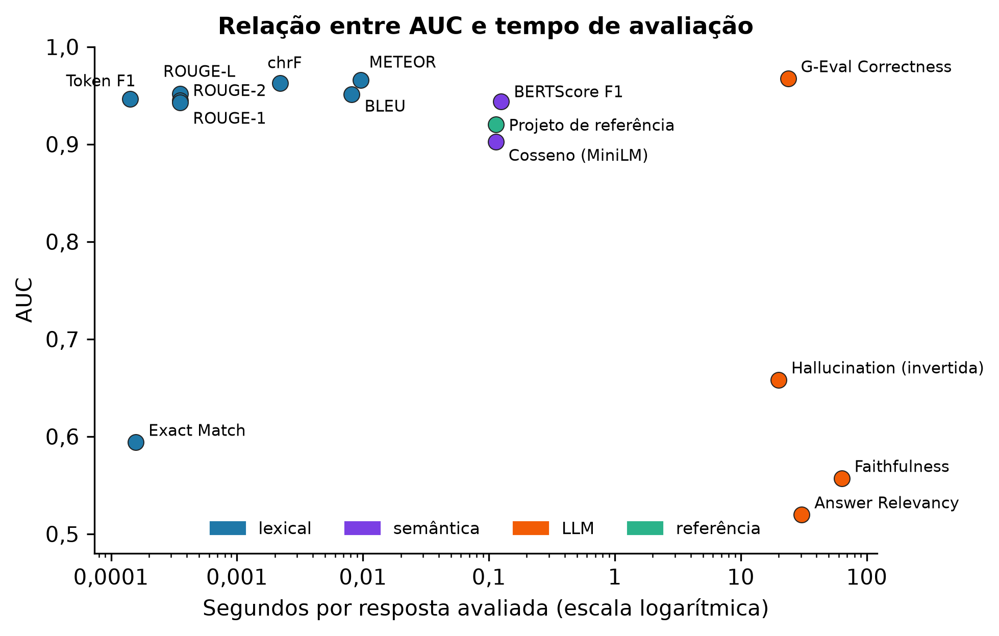

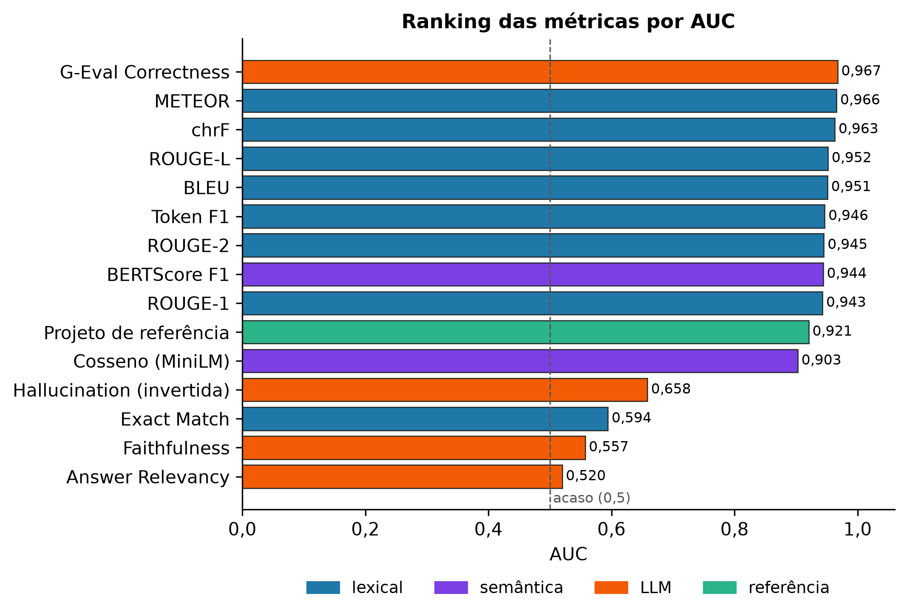

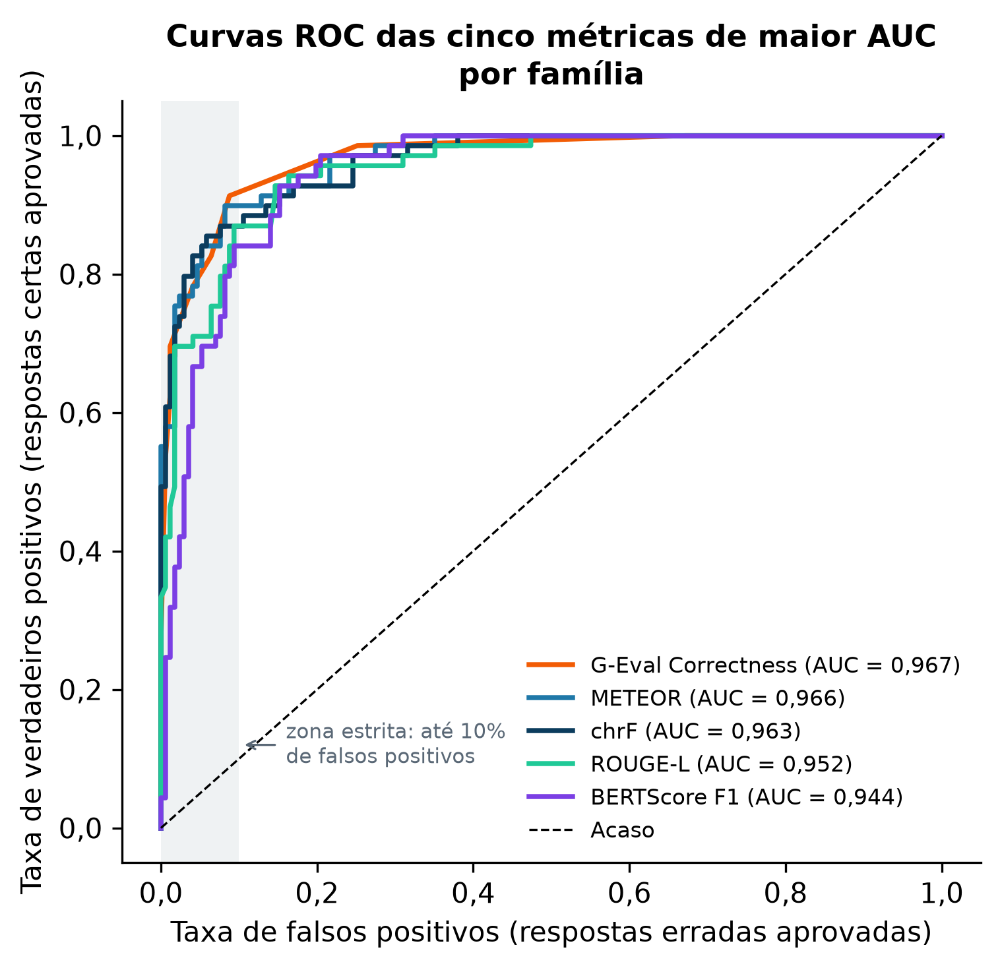

**Figura 1** — *Taxa de respostas corretas de cada modelo sem RAG (azul) e com RAG (laranja), nas 40 perguntas.*
Parágrafo-guia: "Com RAG, os três modelos ficam entre 50% e 55%; sem RAG, entre 5% e 7,5%. A distância entre as condições é muito maior que a distância entre os modelos."

**Figura 2** — *Cobertura média de fatos-chave por modelo. As barras à esquerda do zero representam a condição sem RAG, e as barras à direita, a condição com RAG; os valores são porcentagens positivas nos dois lados.*

**Figura 3** — *Taxa de respostas corretas por configuração (linhas) e tipologia de consulta (colunas). Cada célula de descritivas contém 5 perguntas; de fato curto, 7; de lista curta, 17; de lista longa, 11.*

**Figura 4** — ver seção 4, item 5.

**Figura 5** — ver seção 2.6.

**Figura 6** — *Relação entre a AUC de cada métrica e o tempo médio para avaliar uma resposta (eixo horizontal em escala logarítmica). As cores indicam a família da métrica.*
Parágrafo-guia: "As métricas lexicais ficam no canto superior esquerdo: AUC alta em milissegundos. Entre as de LLM, só a G-Eval alcança AUC comparável, e com tempo de 20 a 63 segundos por resposta."

**Figura 7** — *Ranking das 15 métricas pela AUC, colorido por família. A linha tracejada marca o desempenho ao acaso (0,5).*

**Figura 8** — *Curvas ROC das quatro métricas de maior AUC (G-Eval, METEOR, chrF e ROUGE-L) e da métrica semântica de maior AUC (BERTScore). Cada curva mostra, para todos os limiares possíveis, a taxa de respostas corretas aprovadas contra a taxa de respostas incorretas aprovadas; a diagonal tracejada representa o acaso.*
Justificativa a acrescentar no texto: "A Answer Relevancy, de AUC 0,520, foi omitida para preservar a legibilidade; sua curva praticamente coincide com a diagonal."

**Figura 9** — *Matrizes de confusão da validação cruzada leave-one-model-out, com limiar global, normalizadas pela classe real: cada linha soma 100%. A linha "Incorreta" mostra quantas respostas erradas foram reprovadas (especificidade) e aprovadas (falsos positivos).*

**Por que essas métricas na Figura 5** (texto a acrescentar): "Foram selecionadas métricas representativas das três famílias: duas lexicais com melhor desempenho em limiares distintos (METEOR e ROUGE-L), a semântica de maior AUC (BERTScore), a baseada em LLM de maior AUC (G-Eval) e, como contraste, a de menor AUC (Answer Relevancy)."

---

## 6. As métricas por eixo de avaliação

Proposta de tabela para a seção 4.2. Ela deixa claro que a comparação entre famílias só é possível no primeiro eixo, como observado na conversa com o orientador.

| Eixo | O que pergunta | Lexicais | Semânticas | LLM |
|---|---|---|---|---|
| **Correspondência com o gabarito** | A resposta diz o mesmo que a resposta de referência? | Exact Match, Token F1, BLEU, ROUGE-1, ROUGE-2, ROUGE-L, METEOR, chrF | BERTScore, cosseno MiniLM, projeto de referência | G-Eval Correctness |
| **Contradição com a referência** | A resposta contradiz o gabarito? | — | — | Hallucination |
| **Fidelidade ao contexto recuperado** | A resposta respeita os trechos que o sistema buscou? | — | — | Faithfulness |
| **Relevância para a pergunta** | A resposta trata do assunto perguntado? | — | — | Answer Relevancy |

**A completude** (a resposta contém tudo o que foi pedido?) é medida pela **cobertura de fatos-chave**, que é a régua do estudo, e não uma das métricas comparadas.

**Frase para o artigo:** *"Apenas o eixo de correspondência com o gabarito reúne métricas das três famílias; os demais são cobertos somente por métricas baseadas em LLM, que avaliam propriedades distintas da correção factual. Por isso, sua baixa AUC indica que medem outra dimensão da resposta, e não que sejam inadequadas para o propósito para o qual foram concebidas."*

---

## 7. O que cada métrica mede, como calcula e o que a nota traduz

Pronta para o artigo ou para o texto do TCC.

| Métrica | O que mede | Como calcula | Nota alta significa |
|---|---|---|---|
| Exact Match | Igualdade literal | 1 se resposta e gabarito são idênticos após normalização; senão, 0 | A resposta reproduz o gabarito |
| Token F1 | Palavras em comum | Média harmônica entre a fração das palavras da resposta presentes no gabarito e a fração das do gabarito presentes na resposta | Vocabulário parecido com o do gabarito |
| BLEU | Precisão de sequências | Média geométrica das precisões de sequências de 1 a 4 palavras, com penalidade para respostas curtas | A resposta repete trechos do gabarito |
| ROUGE-1 / 2 / L | Sobreposição de palavras, de pares de palavras e da maior subsequência comum | Medida F entre resposta e gabarito | A resposta cobre o conteúdo do gabarito na mesma ordem |
| METEOR | Alinhamento com peso na revocação | Alinha palavras, combina precisão e revocação (revocação com peso 9) e penaliza alinhamentos fragmentados | **A resposta contém o que o gabarito pede**, na ordem |
| chrF | Sobreposição de caracteres | Medida F de sequências de 1 a 6 caracteres, com a revocação valendo mais | Cobre o gabarito, tolerando variação de flexão |
| Cosseno MiniLM | Proximidade de sentido | Cosseno entre os vetores de frase da resposta e do gabarito | Fala do mesmo assunto, com sentido parecido |
| BERTScore | Proximidade de sentido por palavra | Casa cada palavra com a mais parecida do outro texto, usando vetores contextuais | Palavras com significados equivalentes |
| Projeto de referência | Linha de base anterior | 0,8 × cosseno + 0,2 × similaridade de caracteres | Sentido geral parecido |
| G-Eval Correctness | Correção segundo um critério escrito | Um LLM gera passos de avaliação e dá nota de 0 a 10 comparando resposta e gabarito | A resposta está correta e completa, aceitando paráfrases |
| Hallucination (invertida) | Ausência de contradição com o gabarito | Um LLM verifica se a resposta contradiz o gabarito (com um único contexto, 0 ou 1) | A resposta não contradiz a referência, mas pode estar incompleta |
| Faithfulness | Fidelidade aos trechos recuperados | Um LLM extrai afirmações da resposta e verifica se contradizem o contexto | O gerador respeitou o que foi recuperado |
| Answer Relevancy | Pertinência à pergunta | Um LLM julga se cada afirmação da resposta trata da pergunta | A resposta fala do assunto, certa ou errada |

---

## 8. O que as métricas dizem sobre o TitãsBot

É o tipo de discussão que o orientador citou ("ele alucina menos, mas também produz respostas menos corretas"). Médias das 120 respostas de cada condição:

| Dimensão | Métrica | Sem RAG | Com RAG |
|---|---|---|---|
| Completude factual | Cobertura de fatos-chave | 0,085 | 0,634 |
| Correção | G-Eval | 0,20 | 0,51 |
| Proximidade textual | METEOR | 0,11 | 0,51 |
| Proximidade de sentido | Cosseno MiniLM | 0,41 | 0,69 |
| Não contradição | Hallucination (invertida) | 0,58 | 0,75 |
| Pertinência | Answer Relevancy | 0,97 | 0,86 |
| Fidelidade ao contexto | Faithfulness | — | 0,89 |

**Parágrafo proposto:**
> Lidas em conjunto, as métricas descrevem como o RAG mudou o comportamento do TitãsBot. Com recuperação, as respostas passaram a conter mais fatos esperados (cobertura de 0,09 para 0,63), ficaram mais corretas segundo a G-Eval (0,20 para 0,51), mais próximas do gabarito em palavras (METEOR, 0,11 para 0,51) e em sentido (cosseno, 0,41 para 0,69), e passaram a contradizer menos a referência (Hallucination invertida, 0,58 para 0,75). Ao mesmo tempo, mantiveram alta fidelidade aos trechos recuperados (Faithfulness média de 0,89), o que indica que os erros remanescentes decorrem mais de omissões do contexto do que de contradições. A Answer Relevancy, por sua vez, diminuiu (0,97 para 0,86): sem RAG, as respostas eram frequentemente recusas ou textos genéricos, que, embora incorretos, permaneciam no assunto da pergunta. Esse contraste mostra por que relevância não substitui correção.

---

## 9. Como pronunciar os nomes

| Nome | Pronúncia aproximada | Significado |
|---|---|---|
| chrF | "cê-agá-erre-éfe" ou "carácter éfe" | *character n-gram F-score* |
| METEOR | "mí-tior" | como a palavra inglesa *meteor* |
| ROUGE | "rúj" | do francês, "vermelho" (trocadilho com o BLEU, "azul") |
| BLEU | "blé" ou "blu" | do francês, "azul" |
| BERTScore | "bért-scór" | |
| G-Eval | "dji-ívol" ou "gê-eval" | |
| Token F1 | "tôquen éfe-um" | |
| MiniLM | "míni-éli-éme" | |
| Faithfulness | "féit-fulness" | fidelidade |
| Answer Relevancy | "ânser rélevânsi" | relevância da resposta |
| Hallucination | "ralucinêichon" | alucinação |
| AUC | "a-u-cê" ou "área sob a curva" | |
| ROC | "róc" | *receiver operating characteristic* |
| McNemar | "mac-nímar" | |
| leave-one-model-out | "lív uan módel áut" | deixar um modelo de fora |

---

## 10. Cuidados na apresentação

- **Não diga que fizeram uma "avaliação sociotécnica".** O orientador alertou: os aspectos de organização e de pessoas não foram avaliados, porque o sistema não foi implantado nem testado com usuários. O que vocês mediram são **aspectos práticos de adoção das métricas**: custo, tempo, estabilidade e erros sobre pessoas. Use essa expressão.
- **Restrinja-se ao que está no artigo.** Os números do código e os cálculos complementares servem para responder perguntas, não para a fala.
- **Se a banca perguntar sobre limiar baixo** (a mesma objeção do orientador): use a seção 2. Resposta curta em `ESTUDO_DETALHADO.md`, P34.

---

## 11. Figuras finais: artigo e slides

**Use a pasta `estudo_defesa/figuras_finais/`.** As pastas `figuras_revisadas/` e `figuras_artigo/` são versões intermediárias.

Todas as figuras foram geradas a partir dos dados do experimento, a 300 dpi, com vírgula decimal, nomes completos dos modelos e das métricas e as cores originais do artigo.

### 11.1 Para o artigo (`figuras_finais/artigo/`)

Seguem o padrão atual do artigo, com "Figura N." no topo da imagem e a legenda embaixo, no texto. Se decidirem tirar o título de dentro das imagens, eu gero de novo.

| Arquivo | Substitui | Observação |
|---|---|---|
| `figura1.png` | Figura 1 | |
| `figura2.png` | Figura 2 | Barras lado a lado. **Mude o texto** para "entre 5,8% e 9,9%; com RAG, entre 62,9% e 64,4%" |
| `figura3.png` | Figura 3 | "GPT-5 mini"; uma casa decimal, como o texto |
| `figura4_recomendada_por_condicao.png` | Figura 4 | **Mude o parágrafo** da seção 5.2 (texto na seção 12.1) |
| `figura4_alternativa_agregada.png` | Figura 4 | Mantém o texto atual; o título avisa que soma as condições |
| `figura5_recomendada_faixa_completa.png` | Figura 5 | **Troque o parágrafo** da seção 5.3 (seção 2.6) |
| `figura5_alternativa_a_partir_de_050.png` | Figura 5 | Só se o método mudar (seção 2.5) |
| `figura6_com_projeto_de_referencia.png` / `figura6_sem_projeto_de_referencia.png` | Figura 6 | Escolham conforme a decisão sobre a ref_projeto |
| `figura7_com_projeto_de_referencia.png` / `figura7_sem_projeto_de_referencia.png` | Figura 7 | G-Eval 0,967 e projeto de referência 0,921: **mude também a Tabela 3 e a seção 5.3** |
| `figura8.png` | Figura 8 | |
| `figura9.png` | Figura 9 | |
| `opcional_auc_parcial.png` | Nova, sem número | Só se incluírem o parágrafo da AUC parcial; numerem conforme a posição |

### 11.2 Para os slides (`figuras_finais/slides/`)

Sem o número da figura, com letras maiores, para ler na projeção. É só colar no lugar da imagem atual.

| Arquivo | Slide | Observação |
|---|---|---|
| `slide07_figura1.png` | 7 | |
| `slide08_figura2.png` | 8 | O texto do slide (5,8%–9,9% e 62,9%–64,4%) já bate |
| `slide09_figura3.png` | 9 | |
| `slide09_figura4_agregada.png` | 9 | **Versão agregada de propósito:** os cartões do slide dizem "36–38%" e "13,6%", que são os números agregados |
| `slide11_figura7_com_projeto_de_referencia.png` / `slide11_figura7_sem_projeto_de_referencia.png` | 11 | Use a mesma escolha do artigo. Atenção: o cartão do slide diz "AUC 0.968"; com a figura nova (0,967), troque o cartão também ou explique na fala |
| `slide12_figura9.png` | 12 | |

**Prévia das figuras do artigo (versões recomendadas):**

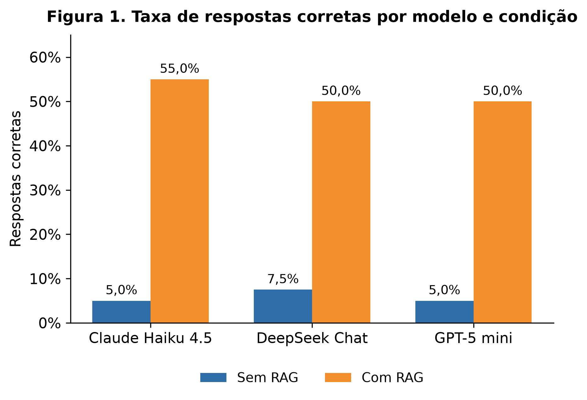

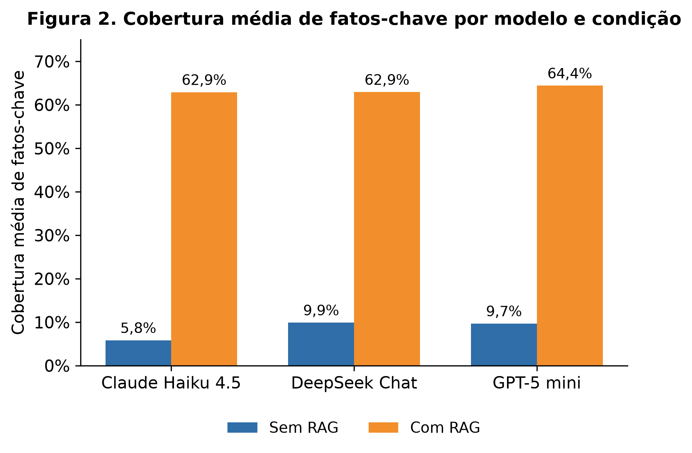

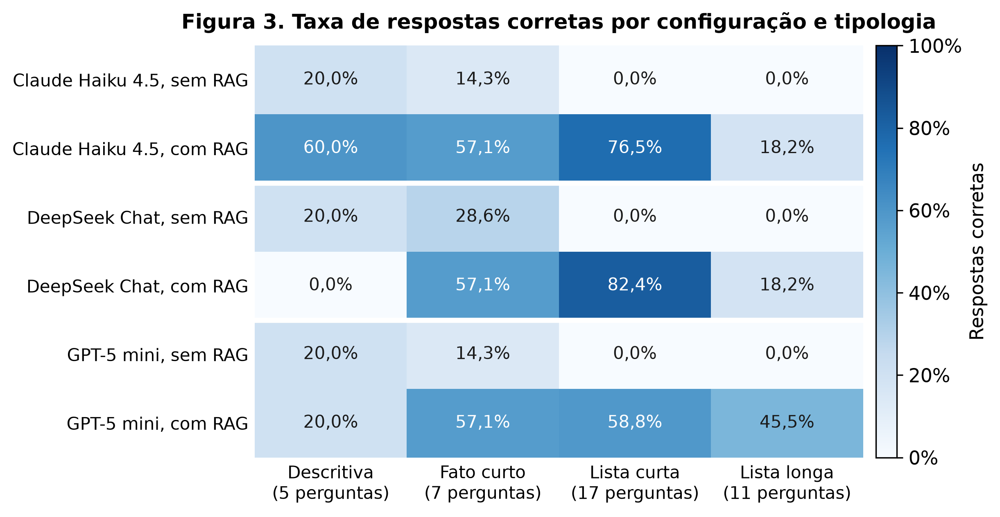

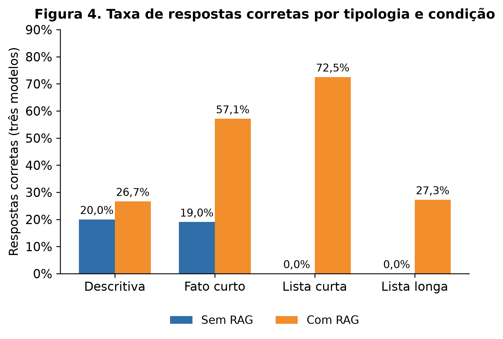

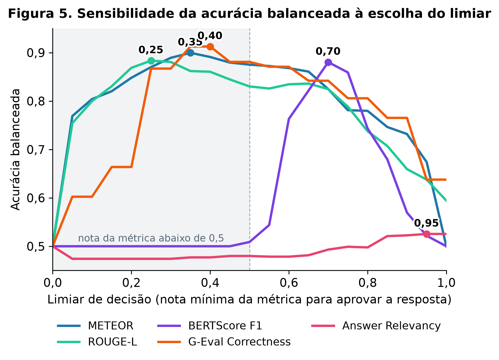

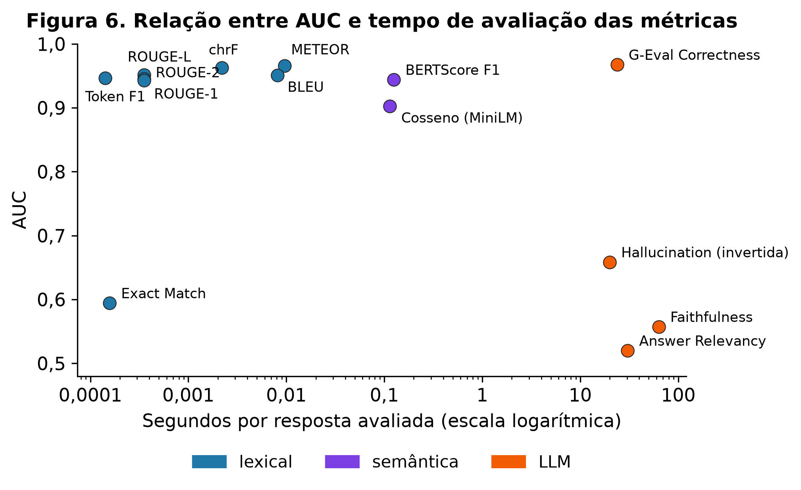

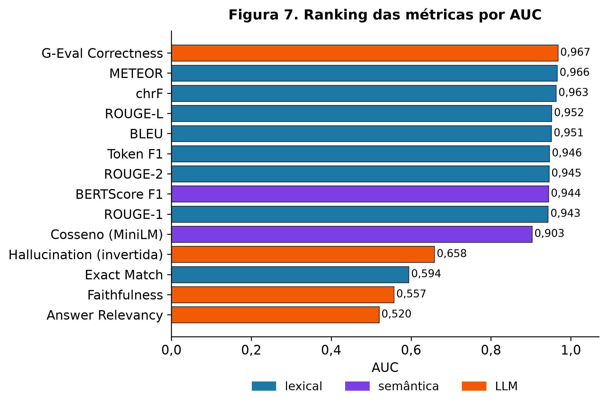

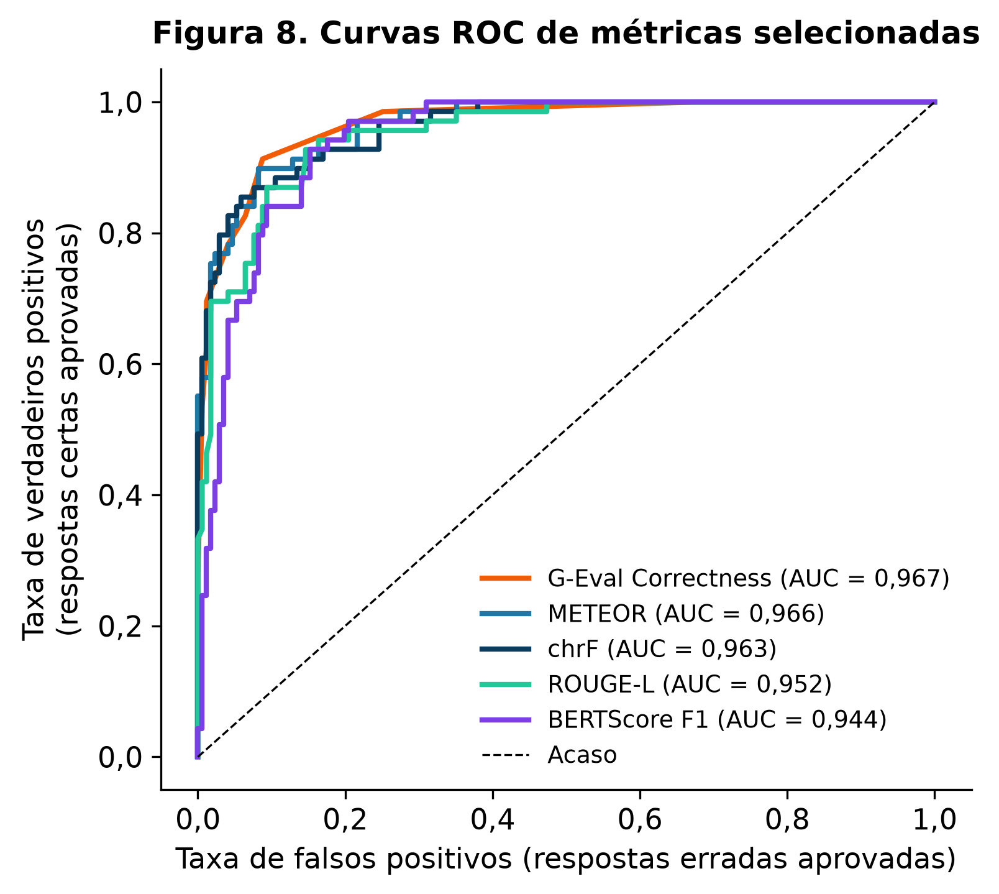

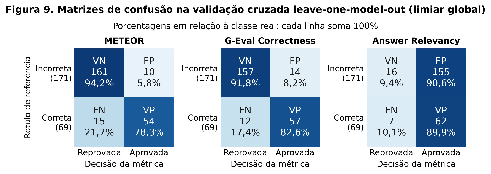

**Prévia das figuras dos slides:**

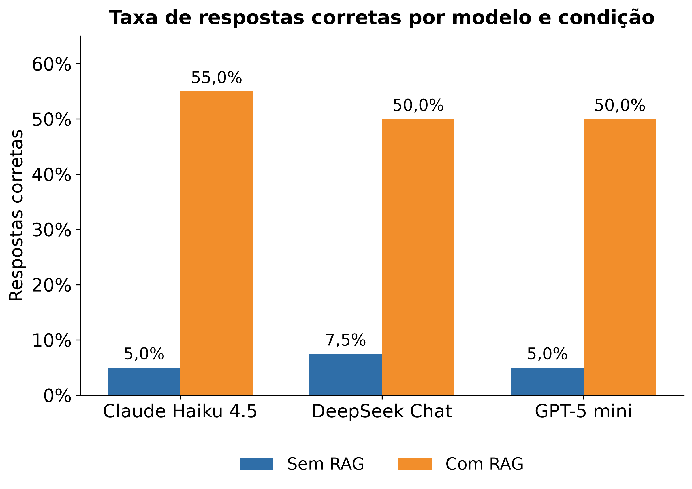

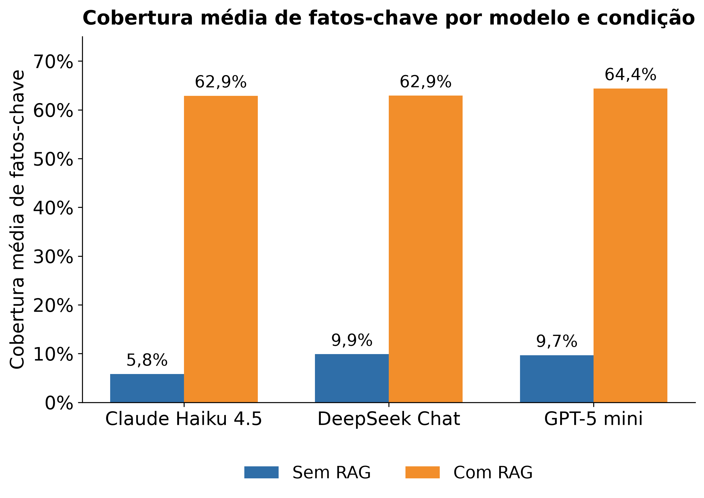

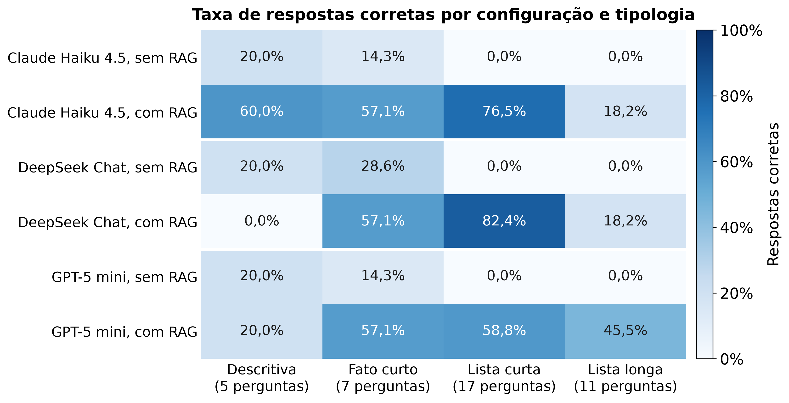

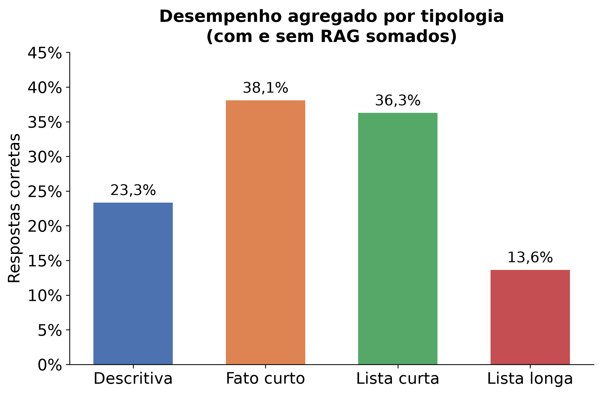

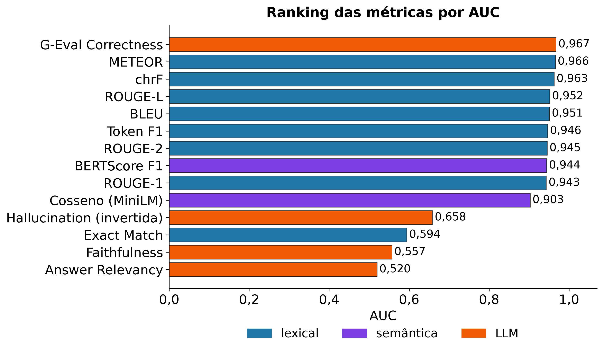

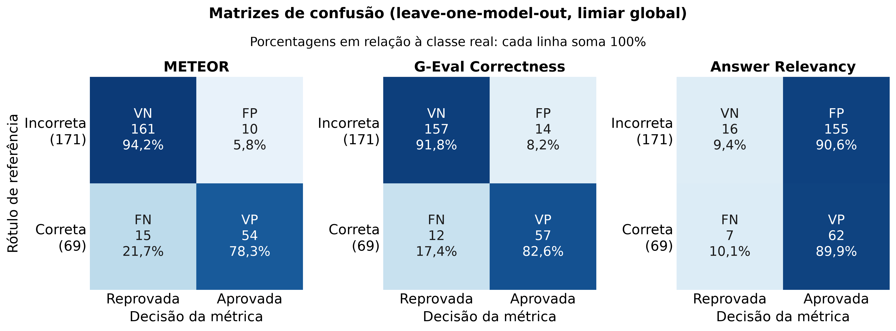

---

## 12. Pedidos repassados pelo Pego (11/11): o que já estava feito, por que fazer e o que evitar

| # | Pedido do orientador | Já estava no escopo? | O que fazer | Por quê | O que evitar |
|---|---|---|---|---|---|
| 1 | Se o gráfico mudou, mudar o texto também | **Em parte** (0,967 e Figura 4) | Seguir o mapa da seção 12.1 | Texto e figura com números diferentes é o erro que a banca mais nota | Trocar a figura e esquecer o parágrafo, a tabela ou a legenda que citam o mesmo número |
| 2 | Legendas que discriminem as métricas | **Em parte** (seção 5) | Usar as legendas da seção 12.2, que nomeiam cada métrica e sua família | O leitor precisa saber o que é cada linha ou barra sem procurar no texto | Legenda que só repete o título; nomes de código |
| 3 | Explicar por que algumas análises usam só algumas métricas | **Em parte** (Figuras 5 e 8) | Acrescentar as justificativas da seção 12.3, incluindo a Tabela 5, a Figura 9 e a Tabela 2 | Sem justificativa, parece escolha a dedo das métricas que favorecem a conclusão | Justificar depois de olhar o resultado ("escolhemos as melhores") sem dizer o critério |
| 4 | Verificar as tabelas | **Sim** (seção 3) e agora completo | Todos os 90 números da Tabela 3 conferem. Ajustes de forma na seção 12.4 | Tabela é o que o avaliador consulta para checar o texto | Mudar um valor na tabela sem mudar no texto e na figura |
| 5 | Tirar "G-Eval" dos nomes das métricas | **Em parte** (o prefixo de código `geval_` já saiu das figuras) | Decidir a interpretação (seção 12.5) | Nome igual em texto, tabela, figura e slides | Trocar o nome só nas figuras e deixar "G-Eval" no texto e na tabela |
| 6 | Explicar acurácia balanceada, AUC e ROC | **Não estava** | Acrescentar o parágrafo da seção 12.6 na seção 4.2 | As Figuras 5 a 9 e a Tabela 3 dependem desses conceitos; o artigo só cita os autores | Um tutorial longo, longe de onde os conceitos são usados; siglas sem definição |

### 12.1 Mapa de coerência: cada figura alterada e o texto que muda junto

| Se trocar… | Mude também | Texto novo |
|---|---|---|
| **Figura 2** (agora em porcentagem) | Seção 5.1, parágrafo depois da Figura 2: "Sem RAG, os valores médios ficaram entre 0,058 e 0,099; com RAG, subiram para aproximadamente 0,629-0,644." | "Sem RAG, a cobertura média ficou entre 5,8% e 9,9%; com RAG, entre 62,9% e 64,4%." |
| **Figura 4** (versão recomendada, por condição) | Seção 5.2: a frase "A Figura 4 resume essas diferenças no conjunto total…" e o parágrafo "No agregado, fatos curtos (38,1%)…" | Ver o texto logo abaixo da tabela |
| **Figura 5** | Seção 5.3: o parágrafo "As curvas revelam comportamentos distintos…" | Seção 2.6 desta aba |
| **Figura 7** (0,967 e 0,921) | Tabela 3 (G-Eval 0,968 → 0,967; projeto de referência 0,920 → 0,921) e seção 5.3 ("G-Eval apresenta a maior AUC, 0,968…") | Trocar os números; nada mais muda |
| **Figura 8** | Seção 5.3: "a Figura 8 apresenta as curvas ROC das métricas mais discriminativas" | Acrescentar o critério da seção 12.3 |
| **Figura 9** | Só a legenda | Seção 12.2 |
| **Tabela 3** (nomes) | Nada no texto, que já usa os nomes por extenso | Seção 12.4 |
| Qualquer figura | Fim da seção 5.3: "permanece na Tabela 4" | "permanece na Tabela 3" |

**Texto novo para a seção 5.2, se usarem a Figura 4 recomendada.** Troque "A Figura 4 resume essas diferenças no conjunto total e facilita a comparação entre as quatro tipologias" por "A Figura 4 resume essas diferenças por tipologia, separando as condições com e sem RAG". Depois, troque o parágrafo que começa em "No agregado" por:

> Com RAG, as listas curtas apresentaram a maior taxa de acerto (72,5%), seguidas dos fatos curtos (57,1%), enquanto listas longas (27,3%) e descritivas (26,7%) ficaram bem abaixo. O baixo percentual das listas longas não significa ausência de benefício do RAG: sem recuperação, nenhuma lista, curta ou longa, foi respondida corretamente, de modo que todo o desempenho observado nesses estratos ocorreu com RAG. A leitura mais adequada é que a recuperação ajudou, mas não foi suficiente para completar a maior parte das respostas extensas. Nas descritivas, o ganho foi pequeno (de 20,0% para 26,7%), e o número reduzido de observações torna comparações mais finas menos estáveis. Como não foi aplicado um teste inferencial entre estratos, essas diferenças devem ser tratadas como tendências do conjunto analisado.

Se usarem a Figura 4 alternativa (agregada), o parágrafo atual pode ficar. Só mude a legenda para dizer que a figura soma as seis configurações.

### 12.2 Legendas que nomeiam cada métrica

**Figura 5:**
> Figura 5 - Acurácia balanceada em função do limiar de decisão para cinco métricas representativas: METEOR e ROUGE-L (lexicais), BERTScore F1 (semântica), G-Eval Correctness e Answer Relevancy (baseadas em LLM). O eixo horizontal é a nota mínima que a métrica precisa atribuir para aprovar a resposta; os pontos marcam o limiar de maior acurácia balanceada; a faixa cinza indica notas abaixo de 0,5. Valores sobre as 240 respostas, com limiar ajustado sobre o conjunto completo.

**Figura 6:**
> Figura 6 - Relação entre a AUC de cada métrica e o tempo médio para avaliar uma resposta (eixo horizontal em escala logarítmica). Em azul, as lexicais (Exact Match, Token F1, BLEU, ROUGE-1, ROUGE-2, ROUGE-L, METEOR e chrF); em roxo, as semânticas (BERTScore F1 e similaridade por cosseno com MiniLM); em laranja, as baseadas em LLM (G-Eval Correctness, Hallucination, Faithfulness e Answer Relevancy); em verde, a pontuação do projeto de referência.

**Figura 7:**
> Figura 7 - Ranking das 15 métricas pela AUC, com as mesmas cores da Figura 6 para as famílias. A linha tracejada marca o desempenho ao acaso (0,5).

**Figura 8:**
> Figura 8 - Curvas ROC das quatro métricas de maior AUC (G-Eval Correctness, METEOR, chrF e ROUGE-L) e da métrica semântica de maior AUC (BERTScore F1). Cada curva mostra, para todos os limiares possíveis, a taxa de respostas corretas aprovadas contra a taxa de respostas incorretas aprovadas; a diagonal tracejada representa o acaso, e a faixa cinza, a zona com até 10% de falsos positivos.

**Figura 9:**
> Figura 9 - Matrizes de confusão de METEOR (lexical), G-Eval Correctness e Answer Relevancy (baseadas em LLM) na validação cruzada leave-one-model-out, com limiar global. Em cada célula, a contagem e a porcentagem em relação à classe real (cada linha soma 100%).

### 12.3 Por que algumas análises usam só algumas métricas

Textos para colar logo antes ou depois de cada figura ou tabela:

- **Figura 5:** "Foram selecionadas métricas representativas das três famílias: duas lexicais cujo melhor desempenho ocorre em limiares distintos (METEOR e ROUGE-L), a semântica de maior AUC (BERTScore F1), a baseada em LLM de maior AUC (G-Eval Correctness) e, como contraste, a de menor AUC (Answer Relevancy)."
- **Figura 8:** "Para preservar a legibilidade, a figura apresenta as quatro métricas de maior AUC e a métrica semântica de maior AUC; a Answer Relevancy foi omitida porque sua curva praticamente coincide com a diagonal."
- **Tabela 5 e Figura 9:** "Foram escolhidas três métricas com perfis de decisão distintos: METEOR, que obteve a maior acurácia balanceada validada entre todas as métricas; G-Eval Correctness, que obteve a maior AUC e o melhor desempenho entre as baseadas em LLM; e Answer Relevancy, que obteve a menor AUC e serve de contraste, por ser uma métrica frequente na avaliação de sistemas RAG que não mede correção factual."
- **Tabela 2:** "A análise de recuperação foi feita em um subconjunto de 20 perguntas, que cobre as quatro tipologias (5 de fato curto, 2 descritivas, 7 de lista curta e 6 de lista longa), para as quais foram anotados manualmente os termos de evidência necessários à resposta." **[CONFIRME COM O PEGO]** por que foram 20 e não 40, para responder se perguntarem.

### 12.4 Tabelas: o que conferimos e o que ajustar

| Tabela | Números | Ajustes de forma |
|---|---|---|
| 1 | ✓ todos conferem | Escrever os valores de p como "1,91 × 10⁻⁶" |
| 2 | ✓ todos conferem | Dizer na legenda que são 20 perguntas e de quais tipos (texto acima) |
| 3 | ✓ os 90 valores conferem | (a) Trocar os nomes de código pelos nomes por extenso (lista abaixo). (b) Dizer na legenda que a ordem é pela maior acurácia balanceada validada, global ou estratificada. (c) G-Eval 0,967 e projeto de referência 0,921, se trocarem a Figura 7. (d) Legenda completa da seção 4, item 7 |
| 5 | ✓ todos conferem | Dizer na legenda que usa limiar global |

**Nomes para a Tabela 3:** `meteor` → METEOR · `rouge1` → ROUGE-1 · `rougeL` → ROUGE-L · `rouge2` → ROUGE-2 · `bertscore_f1` → BERTScore F1 · `geval_correctness` → G-Eval Correctness · `chrf` → chrF · `token_f1` → Token F1 · `cosine_minilm` → Cosseno (MiniLM) · `bleu` → BLEU · `ref_projeto` → Projeto de referência · `hallucination_inv` → Hallucination (invertida) · `exact_match` → Exact Match · `faithfulness` → Faithfulness · `answer_relevancy` → Answer Relevancy.

### 12.5 "Tirar a palavra G-Eval das métricas"

O pedido tem duas leituras possíveis. Confirme com o Pego qual foi.

1. **Tirar os nomes de código, como `geval_correctness`.** Essa leitura combina com a conversa ("tirar onde tiver de eval e deixar só o nome da métrica"). **As figuras corrigidas já fazem isso.** Falta a Tabela 3 (seção 12.4).
2. **Chamar a métrica só de "Correctness".** É possível, mas não recomendo, por três motivos:
   - **G-Eval é o nome do método** que a métrica usa, e o artigo cita Liu et al. (2023). "Correctness" sozinho é genérico e pode ser confundido com outras métricas de correção.
   - **Os slides 11 e 12 dizem "G-Eval"** e não serão editados. A banca veria dois nomes para a mesma coisa.
   - Seria preciso trocar em todos os lugares: resumo, seções 2.5, 4.2, 5.3 e 5.4, Tabelas 3 e 5 e Figuras 5 a 9.

   Se o orientador quiser mesmo assim, use na primeira menção "métrica de correção (Correctness), implementada com o método G-Eval (LIU et al., 2023)" e depois "Correctness" em todo o resto. Eu regero as figuras com esse nome em poucos minutos.

### 12.6 Acurácia balanceada, AUC e ROC no artigo

**Recomendo incluir.** As Figuras 5 a 9 e a Tabela 3 só fazem sentido com esses conceitos. Hoje o artigo cita Fawcett e Brodersen, mas não diz o que as medidas significam. Isso abre espaço para leituras erradas, como a do limiar.

**Onde:** na seção 4.2, logo depois da lista de métricas, onde os conceitos começam a ser usados. **Confira o limite de páginas da MNR** antes de escolher a versão.

**Versão completa (cerca de 230 palavras):**
> Para avaliar as métricas, cada uma foi tratada como um classificador: uma resposta é aprovada quando sua nota atinge um limiar de decisão. Comparando essa decisão com o rótulo de referência, obtém-se a matriz de confusão, com verdadeiros positivos (VP, respostas corretas aprovadas), falsos positivos (FP, incorretas aprovadas), verdadeiros negativos (VN, incorretas reprovadas) e falsos negativos (FN, corretas reprovadas). A sensibilidade, VP/(VP+FN), indica a fração das respostas corretas reconhecidas, e a especificidade, VN/(VN+FP), a fração das incorretas rejeitadas. A acurácia balanceada é a média dessas duas taxas e, diferentemente da acurácia simples, não favorece a classe majoritária, o que é necessário neste estudo, em que 71,25% das respostas são incorretas: uma métrica que reprovasse todas teria acurácia de 71,25%, mas acurácia balanceada de 50% (BRODERSEN et al., 2010). A curva ROC (Receiver Operating Characteristic) é obtida variando o limiar e registrando, para cada valor, a taxa de verdadeiros positivos contra a taxa de falsos positivos; a diagonal representa uma decisão ao acaso. A área sob essa curva (AUC) resume a capacidade de ordenação da métrica e equivale à probabilidade de uma resposta correta, escolhida ao acaso, receber nota maior que uma incorreta, variando de 0,5 (acaso) a 1 (separação perfeita) (FAWCETT, 2006). Por depender apenas da ordem das notas, a AUC permite comparar métricas com escalas diferentes.

**Versão curta (cerca de 90 palavras), se faltar espaço:**
> Cada métrica foi tratada como um classificador, que aprova a resposta quando a nota atinge um limiar. A sensibilidade é a fração das respostas corretas aprovadas, e a especificidade, a fração das incorretas rejeitadas; a acurácia balanceada é a média das duas e não favorece a classe majoritária (BRODERSEN et al., 2010). A curva ROC relaciona essas taxas em todos os limiares, e a área sob ela (AUC) é a probabilidade de uma resposta correta receber nota maior que uma incorreta, de 0,5 (acaso) a 1 (FAWCETT, 2006).

### 12.7 O que não fazer na revisão, em geral

- **Não mudar o método** (por exemplo, limiar mínimo de 0,5) sem refazer as Tabelas 3 e 5, a Figura 9, o texto e o resumo.
- **Não trocar uma figura sem passar pelo mapa da seção 12.1.**
- **Não criar sigla sem defini-la** na primeira vez (VP, FP, VN, FN, ROC, AUC).
- **Não acrescentar a AUC parcial sem a referência** de McClish (1989).
- **Não deixar nome de código** em figura ou tabela.
- **Não passar do limite de páginas** do evento. Se apertar, use as versões curtas.
- **Lembrar que os slides não mudam.** Se o artigo passar a dizer 0,967, a resposta para a diferença com o slide 11 (0,968) já está pronta na aba 3, pergunta H2.

---

## 13. Revisão completa do texto (11/11): pontas soltas, validade e decisões

> Leitura do artigo inteiro atrás de tudo o que pode deixar vocês em aperto na banca: números que não batem, frases que dizem mais do que os dados, coisas que o método usa mas não explica e termos inconsistentes. **Nada foi editado no artigo.**

### 13.1 DeepEval e G-Eval: o que o artigo diz e como chamar a métrica

**O que o artigo diz hoje:**
- **DeepEval não aparece em nenhum lugar.** Não há o erro de chamar a biblioteca de método, mas falta dizer qual ferramenta calculou as quatro métricas de LLM.
- **G-Eval aparece corretamente como método** na seção 2.5 ("O G-Eval exemplifica essa abordagem… (LIU et al., 2023)").
- O nome da métrica varia: "G-Eval Correctness" no resumo e nas seções 2.5 e 4.2, e só "G-Eval" nas seções 5.3 e 5.4.

**Como pensar no nome.** O nome tem duas partes, como "ROUGE-L":

| Parte | O que é | Em "ROUGE-L" | Em "G-Eval Correctness" |
|---|---|---|---|
| Primeira | O **método** de cálculo | ROUGE (sobreposição) | G-Eval (um LLM com critério e passos de avaliação) |
| Segunda | A **variante** ou o critério | L (maior subsequência comum) | Correctness (o critério de correção que **nós** escrevemos) |

No código, a métrica é criada como `GEval(name="Correctness", criteria=…)`: "Correctness" é só o rótulo que demos ao critério. Tirar "G-Eval" e ficar com "Correctness" seria como tirar "ROUGE" e ficar com "L". O leitor perderia o método e a referência que o sustenta.

**Recomendação:**
1. **Manter "G-Eval Correctness"** e, na primeira menção, dizer: "G-Eval Correctness, isto é, o método G-Eval (LIU et al., 2023) aplicado a um critério de correção definido pelos autores (doravante, G-Eval)". Assim, o uso abreviado nas seções 5.3 e 5.4 fica justificado.
2. **Citar o DeepEval** na seção 4.2: "As métricas baseadas em LLM foram calculadas com a biblioteca de código aberto DeepEval (CONFIDENT AI, 2025), com o modelo gpt-5-nano como avaliador."
3. **Não chamar as outras três de "G-Eval".** Answer Relevancy, Faithfulness e Hallucination são métricas próprias do DeepEval e não usam o método G-Eval.

### 13.2 Pontas soltas e incoerências, por gravidade

**Alta: a banca pode pegar e é difícil de explicar.**

| # | Onde | Problema | Correção proposta |
|---|---|---|---|
| A1 | 5.3, comentário da Figura 5 | "G-Eval também alcança valor elevado no conjunto completo, por volta de 0,35-0,40. Esse resultado, porém, cai para 0,875 na validação cruzada." Mistura o **limiar** (0,35–0,40) com a **acurácia**, e compara a versão global dentro da amostra (0,913, que nem aparece no texto) com a estratificada validada (0,875) | "A G-Eval alcança acurácia balanceada de 0,913 no conjunto completo, com limiar entre 0,35 e 0,40; na validação cruzada leave-one-model-out, esse valor cai para 0,872 com limiar global e 0,875 com limiar estratificado." |
| A2 | 5.3, comentário da Figura 6 | "…sua vantagem de AUC sobre METEOR é mínima, enquanto sua acurácia balanceada em validação cruzada é inferior." **Só é verdade na versão estratificada.** Na global, a G-Eval é maior (0,872 contra 0,862) | "…enquanto sua acurácia balanceada validada é inferior à da METEOR na versão estratificada (0,875 contra 0,891), embora ligeiramente superior na versão global (0,872 contra 0,862)." |
| A3 | 4.2 | O **limiar estratificado** não é definido, mas aparece no resumo ("maior acurácia balanceada estratificada"), na Tabela 3 e na seção 5.3 | Seção 4, item 6, desta aba: um limiar escolhido para cada tipologia de resposta |
| A4 | 4.1 | A condição **sem RAG** é descrita como "sem evidências", mas o prompt identificava a equipe (Ifes Campus Colatina e o nome antigo Asimov). Isso explica 6 dos 7 acertos sem RAG (perguntas 1 e 2) | "Na configuração sem RAG, o modelo recebeu apenas a pergunta e uma instrução que identificava a equipe (instituição e nome anterior), o que tornou respondíveis sem recuperação as duas perguntas de identificação da equipe; o efeito do RAG relatado é, portanto, conservador." |
| A5 | 3 e 4.1 | O texto passa a ideia de que a recuperação é igual para os três modelos ("substituir o componente gerador sem reconstruir a cadeia de recuperação"). Mas o **próprio modelo participa da busca** (expansão da consulta e seleção das evidências), e por isso o Hit@5 varia entre os modelos | "Duas etapas da recuperação, a expansão da consulta e a seleção das evidências, são executadas pelo próprio modelo gerador; o índice, os embeddings e a pontuação híbrida são os mesmos, mas o contexto final pode variar entre os modelos." |
| A6 | 4.2 | O **Hit@5** e a Precision@5 só aparecem nos resultados. O método não diz como foram calculados nem que são 20 perguntas | Seção 4, item 6, e seção 12.3 desta aba |
| A7 | 4.2 | O **DeepEval** e o **modelo avaliador** (gpt-5-nano) não são informados | Seção 13.1 |
| A8 | 2.5 | A Hallucination é descrita como avaliando "presença de informações não sustentadas". **Na configuração usada, ela verifica contradição com o gabarito.** No laboratório, ela não detectou omissão nem um fato inventado a mais | "…e contradição com uma referência (Hallucination)." |

**Média: um especialista pode questionar.**

| # | Onde | Problema | Correção proposta |
|---|---|---|---|
| M1 | 2.5 | "METEOR e chrF admitem comparações mais flexíveis…". Em português, o METEOR **não usa** sinônimos nem radicais (o WordNet é em inglês) | Acrescentar: "neste estudo, sem recursos de sinonímia para o português, o METEOR opera por correspondência exata de palavras, com ênfase na revocação" |
| M2 | 4.2 × 2.5 | "similaridade por embeddings" (4.2) e "similaridade por cosseno com MiniLM" (2.5) são a mesma métrica com nomes diferentes | Usar sempre "similaridade por cosseno (MiniLM)" |
| M3 | 2.4 e 3 | O MiniLM aparece na seção de recuperação, mas a busca usa embeddings da OpenAI. "OpenAIEmbeddings" é o nome de uma classe do LangChain, não de um modelo | Seção 3: "…convertidos em embeddings pelo modelo text-embedding-3-small, da OpenAI". Seção 2.4: deixar claro que o MiniLM é usado na avaliação |
| M4 | 4.1 | "fatos-chave revisados": revisados por quem? E como são encontrados na resposta? | "…decompostas pelos autores em fatos-chave… A cobertura foi calculada automaticamente, por regras de correspondência para termos, nomes de pessoas e colocações." |
| M5 | 4.1 | "40 perguntas… elaboradas a partir do domínio documental": não diz de onde vêm | "…extraídas do conjunto oficial de perguntas e respostas da equipe, que serviu de gabarito" |
| M6 | Tabela 3 | A Faithfulness tem 117 respostas, não 240, e isso não é dito | Nota na legenda (seção 4, item 7) |
| M7 | 5.3 e 5.4 | "G-Eval" e "G-Eval Correctness" alternados | Seção 13.1, item 1 |
| M8 | Limitações | O sistema foi desenvolvido com o gabarito à vista (por exemplo, a pergunta 40 é respondida por uma regra fixa). Isso não está no artigo | Acrescentar às limitações: "o sistema foi desenvolvido com o conjunto de perguntas à vista, de modo que o acerto absoluto é uma estimativa otimista para perguntas novas; o efeito do RAG, no entanto, persiste mesmo excluindo as perguntas afetadas" |
| M9 | Régua | Na pergunta 7, o gabarito diz LARC e o livro diz II TRUFES. Uma resposta que seguiu o livro foi marcada errada | Opcional: citar como exemplo da limitação da régua. **Não** corrigir o gabarito agora, porque mudaria um rótulo depois da análise |

**Baixa: forma.**

| # | Onde | Problema | Correção |
|---|---|---|---|
| F1 | 5.3 (duas vezes) e 5.2 | "threshold" e "retrieval" em inglês no meio do texto | "limiar" e "recuperação" |
| F2 | Resumo | "Palavras Chaves" | "Palavras-chave" |
| F3 | Abstract | Termina com dois pontos finais ("quality..") | Um só |
| F4 | Seção 2, introdução | "tanto o funcionamento do sistema quanto às análises" | "quanto as análises" (sem crase) |
| F5 | Tabela 2 | "Precision @5" | "Precision@5" |
| F6 | 5.3 | "Tabela 4" | "Tabela 3" |
| F7 | Tabela 1 | "1,91e-06" | "1,91 × 10⁻⁶" |
| F8 | Cabeçalho | "MNR 2019" | "MNR 2026" |
| F9 | Tabela 3 e Figuras 6 e 7 | Nomes de código | Nomes por extenso (seção 12.4) |
| F10 | Tabela 3, Figura 7 e 5.3 | 0,968 e 0,920 | 0,967 e 0,921 |
| F11 | Conclusões | Uma limitação só | Seção 4, item 11 |

### 13.3 As métricas são reconhecidas e válidas?

**Sim, todas exceto a ref_projeto.** Algumas foram usadas com uma configuração diferente da original. Isso é aceitável **desde que esteja declarado**, e hoje não está.

| Métrica | Origem | Reconhecida? | O que declarar no artigo |
|---|---|---|---|
| Exact Match, Token F1 | Rajpurkar et al. (2016), SQuAD | Sim | Citar Rajpurkar et al. (falta nas referências) |
| BLEU | Papineni et al. (2002) | Sim | — |
| ROUGE-1, -2, -L | Lin (2004) | Sim | — |
| METEOR | Banerjee e Lavie (2005) | Sim | Sem sinonímia em português (M1) |
| chrF | Popović (2015) | Sim | — |
| BERTScore | Zhang et al. (2020) | Sim | Modelo multilíngue e **sem reescalonamento pela linha de base**: explica o limiar de 0,70 |
| Cosseno MiniLM | Reimers e Gurevych (2019); Wang et al. (2020) | Sim, como medida de similaridade | — |
| G-Eval Correctness | Liu et al. (2023) | Sim | Critério escrito pelos autores; gpt-5-nano dá nota inteira, sem a ponderação por probabilidade do original |
| Answer Relevancy, Faithfulness | Linha do RAGAS (Es et al., 2023), implementadas no DeepEval | Sim | Citar Es et al. e o DeepEval |
| Hallucination | DeepEval | Métrica de biblioteca, sem artigo próprio | **Uso fora do padrão:** o contexto foi o gabarito, e não os documentos recuperados. Declarar |
| ref_projeto | Projeto de referência | **Não** | Seção 13.4 |

### 13.4 A ref_projeto: tirar ou manter?

| | Tirar | Manter |
|---|---|---|
| A favor | Não é uma métrica reconhecida. Repete o cosseno (correlação de 0,987), que já está no estudo. Exige explicação num artigo com limite de páginas. Tirar deixa só três famílias nas figuras (some a cor "referência"). **Não muda nenhuma conclusão**: ela está em 11º de 15 lugares | Foi o ponto de partida indicado pelo orientador. Serve de linha de base: mostra que o método anterior fica atrás das métricas reconhecidas |
| O que muda no artigo | 1 frase na seção 4.2, 1 linha na Tabela 3 e as Figuras 6 e 7 (eu refaço). **O artigo não cita "15 métricas" em nenhum lugar**, então não há contagem a corrigir | Trocar "métrica de referência específica do projeto" por uma descrição clara (seção 4, item 4) |
| O que muda na defesa | O **slide 11 mostra a Figura 7 antiga**, com a ref_projeto e os nomes de código. É preciso trocar a imagem do slide (veja abaixo) ou explicar a diferença. A fala diz "15 métricas" e passaria a "14" | Nada |

**Minha recomendação: tirar, se o orientador concordar.** Ele indicou o projeto, então a decisão precisa passar por ele. O argumento para levar: "Ela praticamente coincide com o cosseno, que já está no estudo, e não é uma métrica reconhecida; tirá-la deixa o artigo só com métricas da literatura e não muda nenhum resultado."

**Sobre o slide 11:** ele mostra a Figura 7 antiga, com `geval_correctness`, `ref_projeto` e ponto decimal. Mesmo que os slides não mudem em mais nada, **vale trocar só essa imagem** pela Figura 7 corrigida. É colar uma imagem, e o slide passa a bater com o artigo. Se a ref_projeto sair, eu gero a Figura 7 sem ela.

### 13.5 Todos os pedidos do orientador, num lugar só

| Pedido | Origem | Situação |
|---|---|---|
| Limiar baixo na Figura 5 | Conversa de 10/11 | Analisado; figura recomendada e alternativa prontas (seção 2) |
| Por que só algumas métricas nos gráficos | 10/11 e Pego (11/11) | Justificativas prontas para as Figuras 5, 8 e 9 e as Tabelas 2 e 5 (seção 12.3) |
| Confirmar se os gráficos batem com os dados | 10/11 | Feito: todos batem (seção 3) |
| Nomes das métricas sem "eval"/nomes de código | 10/11 e Pego | Figuras prontas; falta a Tabela 3; manter "G-Eval Correctness" (seção 13.1) |
| Explicar o que cada métrica mede, como calcula e o objetivo | 10/11 | Tabela pronta (seção 7) e descrições por família para a seção 2.5 (em debate) |
| Categorizar as métricas por eixo | 10/11 | Tabela pronta (seção 6) |
| Legendas mais detalhadas, sem deixar o leitor concluir sozinho | 10/11 e Pego | Legendas prontas (seções 5 e 12.2) |
| Discussão "alucina menos, acerta mais" | 10/11 | Parágrafo pronto (seção 8) |
| Mudou o gráfico, mudar o texto | Pego | Mapa de coerência (seção 12.1) |
| Verificar as tabelas | Pego | Feito: todos os valores conferem; ajustes de forma (seção 12.4) |
| Explicar acurácia balanceada, AUC e ROC | Pego | Parágrafo pronto, em duas versões (seção 12.6) |
| Não chamar de "avaliação sociotécnica" | 10/11 | Corrigido no material; o artigo não usa o termo |
| Ater-se ao que está no artigo na apresentação | 10/11 | Regra registrada (seção 10) |

### 13.6 Decisões que precisam ser tomadas antes de editar

1. **Figura 5:** versão recomendada (faixa completa) ou a partir de 0,5?
2. **Figura 4:** por condição (recomendada) ou agregada?
3. **ref_projeto:** tirar ou manter? (Passa pelo orientador.)
4. **Título dentro das imagens:** tirar (recomendado) ou manter igual ao original?
5. **Descrições das métricas:** expandir a seção 2.5 ou criar um quadro na 4.2?
6. **AUC parcial:** incluir o parágrafo e a referência de McClish?
7. **Limite de páginas da MNR:** quanto espaço sobra? Isso decide entre as versões completa e curta dos textos novos.
8. **Slide 11:** trocar só a imagem da Figura 7?

### 13.7 O que foi aplicado no Google Doc (11/11/2026)

Edição feita direto na cópia "MNR2026_ART_RAG - victor".

- **Figura 5:** decisão do Victor, a versão **a partir de 0,5** (`figura5_alternativa_a_partir_de_050.png`). Para não criar a incoerência da seção 2.5, o texto passou a dizer:
  - a figura mostra a faixa a partir de 0,5;
  - nessa faixa, METEOR e G-Eval têm o melhor ponto em 0,50 (BA 0,875 e 0,881), ROUGE-L em 0,65 (0,836) e BERTScore em 0,70 (0,880);
  - na varredura completa, os melhores limiares de METEOR e ROUGE-L ficam abaixo de 0,5 (0,35 e 0,25);
  - o limiar da Tabela 3 vem da varredura de 0 a 1;
  - o parágrafo da AUC parcial cita a Figura 5.
- **Figura 4:** versão por condição. **Figuras 6 e 7:** sem ref_projeto. **Demais figuras:** versões de `figuras_finais/artigo`, sem corte e com a proporção original.
- **Tabela 3:** sem ref_projeto, com nomes padronizados. A coluna de nomes ficou mais larga para não quebrar "METEOR", "ROUGE-1" etc.
- **Custo na Tabela 3:** o texto diz "total gasto com o modelo avaliador ao longo do experimento". Os valores incluem 72 reavaliações de estabilidade. Só a rodada principal daria G-Eval US$ 0,33, Hallucination 0,28, Answer Relevancy 0,40 e Faithfulness 0,45.
- **Ajustes finos:**
  - Hit@5 descrito como "trecho suficiente" na seção 5.2;
  - Answer Relevancy "entre 0,47 e 0,53";
  - METEOR "maior BA validada com limiar estratificado" na seção 5.4;
  - Figura 9 centralizada.
- **Segunda rodada (pedido do Victor):**
  - **Figuras limpas.** Saíram a faixa cinza "zona estrita" da Figura 8 e a linha tracejada "acaso (0,5)" da Figura 7. A Figura 9 ganhou título e subtítulo sem espaço vazio. A Figura 5 é a versão a partir de 0,5, sem área cinza.
  - **Legendas descritivas nas 9 figuras.** Cada uma diz o que o gráfico mostra, os eixos, as métricas e a cor de cada família.
  - **Descrição das métricas na 4.2.** Cada métrica foi descrita onde ela é listada: o que mede e como foi calculada.
    - Normalização em minúsculas, sem acento.
    - BLEU por resposta, com suavização; ROUGE com medida F.
    - BERTScore com bert-base-multilingual-cased, sem reescalonamento; cosseno com paraphrase-multilingual-MiniLM-L12-v2.
    - Critério da G-Eval; Answer Relevancy e Faithfulness como proporção de afirmações.
    - Hallucination contra a referência, na prática 0 ou 1, invertida.
  - **Seção 2.5 só conceitual.** Ficaram as famílias, com as citações; a descrição detalhada foi para a 4.2, para não repetir.
- **Releitura e diagramação final:**
  - **Correções de forma:**
    - "recuperação, contextualização e geração";
    - aspas duplas na seção 5.4;
    - legenda e fonte da Figura 10 no padrão das demais.
  - **Figuras e títulos de tabela:** "manter com o próximo", para nunca separar da legenda ou da tabela.
  - **Seção 5.4:** três parágrafos longos deixaram de travar o fluxo entre colunas.
  - **Tabela 1:** quebra de coluna antes do título, para não partir a tabela. Se o texto antes dela mudar, conferir esse ponto.
  - **Resultado:** 12 páginas, sem tabela partida e sem figura separada da legenda.
- **Ajustes pedidos depois:**
  - **Figura 5:** os valores dos limiares estão em preto e negrito, com contorno branco. Cada uma das 5 métricas tem o seu número: o "0,50" da G-Eval fica acima das linhas, o "0,50" do METEOR logo abaixo (as duas têm o melhor ponto no mesmo limiar), e o "0,65" foi para um espaço livre.
  - **Figura 6:** a legenda das famílias está embaixo, na horizontal, como na Figura 1. O gráfico ficou um pouco mais baixo, para manter a altura e não empurrar a Figura 7; o artigo continua com 12 páginas.
